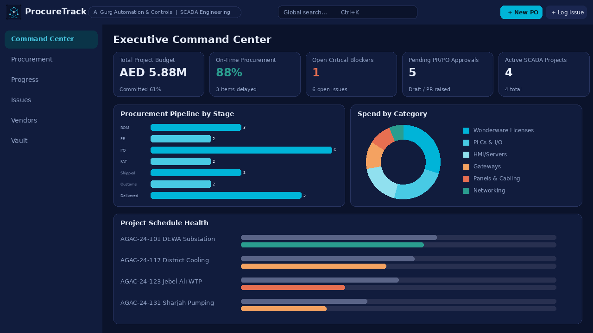
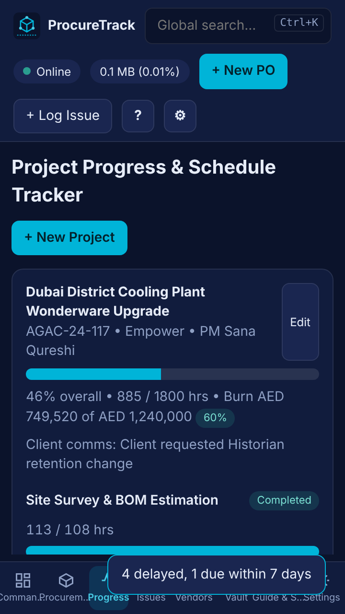
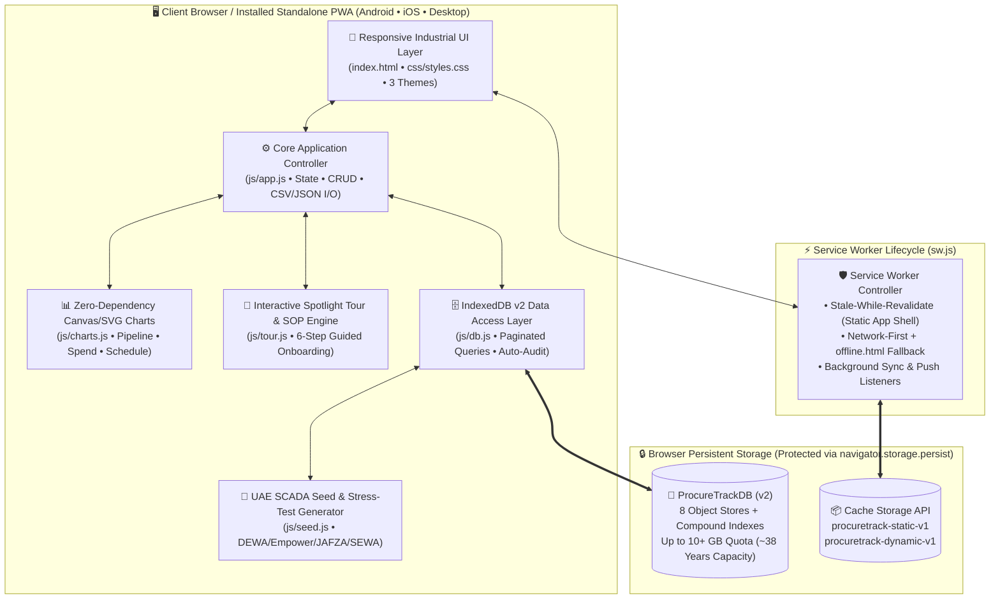
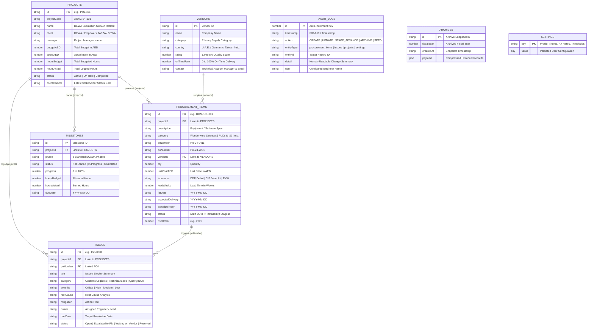

<div align="center">


# ProcureTrack Dashboard (v2.0)
### Industrial SCADA Supply Chain, Project Progress & Vendor Management Hub

[](https://githubbest729.github.io/ProcureTrack-Dashboard/#dashboard)
[](https://githubbest729.github.io/ProcureTrack-Dashboard/#dashboard)
[](https://githubbest729.github.io/ProcureTrack-Dashboard/#vault)
[](https://githubbest729.github.io/ProcureTrack-Dashboard/#guide)
[](#4-issue-blocker--ncr-register-issues)

<p align="center">
  <strong>Live Production Deployment:</strong><br/>
  <a href="https://githubbest729.github.io/ProcureTrack-Dashboard/#dashboard"><strong>🌐 Launch ProcureTrack Dashboard v2.0 (GitHub Pages)</strong></a>
  &nbsp;•&nbsp;
  <a href="#-system-architecture--mermaid-diagrams">📐 Architecture Diagrams</a>
  &nbsp;•&nbsp;
  <a href="#-8-core-application-modules">⚡ Core Modules</a>
  &nbsp;•&nbsp;
  <a href="#-3-year-persistent-storage-vault-procuretrackdb-v2">🗄️ 3-Year Storage Vault</a>
</p>

</div>

---

## 🎯 Executive Purpose & Engineering Mandate

**ProcureTrack Dashboard** is a zero-dependency, offline-first **Universal Progressive Web App (PWA)** engineered specifically for **SCADA & Control Systems Engineers at Al Gurg Automation and Controls (Dubai, U.A.E.)** to execute **Task 16 / Task 21**:

> *"Oversee project procurement management. Monitor project progress and handle any issues that arise."*

In industrial automation projects across the U.A.E.—spanning **Wonderware / AVEVA System Platform**, **Siemens S7-1500 redundant PLCs**, **Moxa Modbus/OPC-UA gateways**, **SQL Historian servers**, and **custom marshalling panels**—engineering schedules are tightly coupled with supply chain lead times, Factory Acceptance Testing (FAT), Jebel Ali Port customs clearance, and Site Acceptance Testing (SAT).

ProcureTrack unifies these workflows into a single operational command center:
1. **End-to-End Procurement Pipeline:** Track every Bill of Materials (BOM) tag from site survey estimation through Purchase Requisition (PR), Purchase Order (PO), manufacturing, FAT clearance, shipping under Dubai Incoterms (`DDP Dubai`, `CIF Jebel Ali`, `EXW`), customs clearance, and site installation.
2. **Multi-Disciplinary SCADA Progress Tracking:** Monitor budgeted vs. actual engineering hours, milestone completion percentages, and financial burn rates across all 8 SCADA execution phases.
3. **Proactive Blocker, Issue & NCR Resolution:** Log, escalate, and resolve supply chain delays, customs holds, Wonderware OI server firmware mismatches, and Non-Conformance Reports (NCRs) in full alignment with **QHSE Annexure-SCT-HR-001**.
4. **3-Year Future-Proof Local Storage Vault:** Powered by an 8-store **IndexedDB v2** engine with persistent storage locking (`navigator.storage.persist()`), immutable audit trails, fiscal year archiving, and instant CSV/JSON portability.

---

## 🖼️ Visual UI Previews

<div align="center">
  <table>
    <tr>
      <td align="center" width="68%">
        <br/>
        <sub><strong>Desktop / Control Room Wide View (1280×720)</strong> — Executive Command Center, KPI Telemetry & Native Canvas Charts</sub>
      </td>
      <td align="center" width="32%">
        <br/>
        <sub><strong>Mobile / Site Survey Field View (720×1280)</strong> — Responsive Touch UI</sub>
      </td>
    </tr>
  </table>
</div>

---

## 🏗️ System Architecture & Mermaid Diagrams

### 1. High-Level Offline-First PWA Architecture



---

### 2. 6-Stage Industrial SCADA Procurement & Engineering Workflow

```mermaid
stateDiagram-v2
    direction LR
    [*] --> Stage1

    state "Stage 1: Site Survey & BOM" as Stage1
    state "Stage 2: PR & Vendor Quote" as Stage2
    state "Stage 3: PO & Manufacturing" as Stage3
    state "Stage 4: FAT & Quality Check" as Stage4
    state "Stage 5: Jebel Ali Customs & Transit" as Stage5
    state "Stage 6: Site SAT, QHSE & Handover" as Stage6

    Stage1 --> Stage2 : BOM Approved\n(Draft BOM → PR Raised)
    Stage2 --> Stage3 : Commercial Sign-Off\n(PO Issued)
    Stage3 --> Stage4 : Assembly Complete\n(In Manufacturing → Ready for FAT)
    Stage4 --> Stage5 : FAT Witnessed & Passed\n(In Transit / CIF Jebel Ali)
    Stage5 --> Stage6 : Customs Cleared\n(Delivered to Site → Installed)
    Stage6 --> [*] : SAT Signed & Archived

    Stage3 --> IssueBlocker : Lead-Time Delay
    Stage4 --> IssueBlocker : Quality NCR
    Stage5 --> IssueBlocker : Customs Hold / Permit Missing
    IssueBlocker --> Stage4 : Mitigation & Re-Test
    IssueBlocker --> Stage6 : Escalated to PM & Resolved

    state "⚠️ Issue, Blocker & NCR Register" as IssueBlocker
```



---

### 3. `ProcureTrackDB` (Version 2) Entity-Relationship Schema



---

## ⚡ 8 Core Application Modules

### 1. Executive Command Center (`#dashboard`)
* **Collapsible Role Mandate Banner:** Clearly communicates the app's purpose for Task 16 at Al Gurg Automation & Controls, complete with one-click launchers for **`▶ Start Interactive Tour`**, **`📖 How-To Workflow Guide`**, and **`⚡ Quick Advance Delayed POs`** (remembers hide/show state).
* **5 Real-Time KPI Cards:**
  * *Total Project Budget* (formatted cleanly in `AED M` with committed spend percentage).
  * *On-Time Procurement Rate (%)* with active delayed item count.
  * *Open Critical Blockers* across all active sites.
  * *Pending PR/PO Approvals* (`Draft BOM` + `PR Raised`).
  * *Active SCADA Projects* count.
* **Zero-Dependency Native Charts (`js/charts.js`):**
  * **Procurement Pipeline by Stage:** Horizontal bar chart tracking item counts across `BOM`, `PR`, `PO`, `FAT`, `Shipped`, `Customs`, and `Delivered`.
  * **Spend by Category:** Interactive multi-segment donut chart breaking down capital expenditure across *PLCs & I/O*, *Wonderware Licenses*, *Panels & Cabling*, *HMI/Servers*, *OPC/Modbus Gateways*, *UPS & Power*, and *Networking*.
  * **Project Schedule Health:** Full, non-truncated project titles stacked cleanly above dual *Planned vs. Actual* horizontal progress bars.
* **Actionable "Attention Needed" Feed:** Structured alert mini-cards for critical issues, customs holds, and due-soon POs with direct **`Inspect →`** buttons that jump straight to the filtered record.

### 2. Procurement & BOM Pipeline (`#procurement`)
* **Full Lifecycle CRUD:** Create, edit, filter, and expedite equipment and software licenses across 9 granular statuses:
  `Draft BOM` → `PR Raised` → `PO Issued` → `In Manufacturing` → `Ready for FAT` → `In Transit` → `Customs Hold` → `Delivered to Site` → `Installed`.
* **One-Click Stage Advancement (`Next Stage ➔`):** Advance any BOM item to its next logical supply-chain stage directly from the table row, automatically logging the transition in the immutable audit trail.
* **Multi-Currency Conversion:** Toggle instant table valuation between **AED** (base), **USD**, **EUR**, and **GBP** using customizable FX rates.
* **Instant Indexed Filtering:** Filter by project code, procurement stage, equipment category, text search, or a **"Delayed only"** toggle, with one-click **CSV Export**.

### 3. Project Progress & Schedule Tracker (`#progress`)
* **Spacious 2-Column Project Cards:** Displays project code, client (`DEWA`, `Empower`, `JAFZA Utilities`, `SEWA`), Project Manager, overall completion %, total hours (`Actual / Budget hrs`), expenditure burn rate, and latest client communication status.
* **8 Standard SCADA Execution Phases per Project:**
  1. *Site Survey & BOM Estimation*
  2. *Wonderware SCADA & HMI Design*
  3. *PLC & Modbus/OPC Integration*
  4. *SQL Database & Reporting*
  5. *Procurement & FAT*
  6. *Site Delivery & SAT*
  7. *Documentation & Client Training*
  8. *QHSE Compliance (Annexure-SCT-HR-001)*
* **Interactive Live Controls:** Adjust milestone completion in real time using smooth range sliders, **`+10%`** quick-increment buttons, or the detailed milestone **`Edit`** modal.

### 4. Issue, Blocker & NCR Register (`#issues`)
* **Supply Chain & Engineering Escalation:** Track blockers linked to both a specific **Project Code** and **PO Number**.
* **Categorization & Severity:** Classify by *Customs/Logistics*, *Technical/Spec Mismatch*, *Supply Chain Delay*, *Quality/NCR*, *Site Readiness*, or *Budget Blocker* across *Critical*, *High*, *Medium*, and *Low* severities.
* **Root Cause & Mitigation Tracking:** Document root causes, mitigation action plans, responsible owners, and target due dates, or export an **Open Blockers CSV** for management review meetings.

### 5. Approved Vendor & Supplier Directory (`#vendors`)
* Maintain regional U.A.E. and international automation suppliers with quality ratings (`1.0–5.0 ★`), historical on-time delivery percentages, primary equipment categories, country of origin, active PO counts, and technical account manager contacts.

### 6. 3-Year Storage Vault, Audit & Backup (`#vault`)
* **Multi-Segment Storage Telemetry Meter:** Visualizes exact IndexedDB usage vs. browser quota (e.g., `0.70 MB of 10.00 GB quota • 0.01%`), persistent lock status (`Locked — protected from eviction`), and estimated years of remaining capacity (`~38 years at ~80 records/day`).
* **Zero-Data-Loss Backup & Restore:** Full database JSON dump and one-click JSON restore with **Merge** or **Overwrite** modes.
* **Dedicated CSV Generators:** One-click generation of **BOM Costing Sheet**, **Expediting Status Report**, and **Open Blockers Report** stamped with the configured Engineer Sign-Off Title.
* **Fiscal Year Archiver:** Compress and archive completed items from prior fiscal years into snapshot storage while keeping them searchable.
* **5,000-Row Stress-Test Generator:** Built-in benchmark button (`Add 5,000 test rows`) to verify 60fps paginated table performance under multi-year load.

### 7. Interactive Guide, 6-Stage Workflow & SOP Center (`#guide`)
* **Clickable 6-Stage Workflow Map:** Click any stage from *Stage 1: Site Survey & BOM* to *Stage 6: SAT, QHSE & Handover* to view specific **SCADA Engineer Responsibilities**, an interactive **Persistent Checklist** (saved automatically), **Required Paperwork**, and a **`Go to Filtered View →`** deep-link button.
* **60-Second Spotlight Tour (`js/tour.js`):** Interactive 6-step guided overlay with `Back`, `Next`, and `Skip` controls highlighting key interface areas.
* **SOP & FAQ Accordions:** Built-in operational procedures for customs holds, Wonderware/PLC hour logging, estimation CSV exports, and IndexedDB storage management.

### 8. Engineer Profile, Ergonomics & SLA Settings (`#settings` & Slide-Over Drawer)
* Accessible via both the left sidebar (`Settings`) and the top navigation gear icon (`⚙`):
  * **Engineer Profile & Role:** Customize Engineer Name, Employee ID, Office Location (*Dubai, U.A.E.*), Business Unit (*Al Gurg Automation & Controls*), and Default Sign-Off Title for exported CSV reports.
  * **Appearance & Ergonomics:** Switch between **3 Industrial Themes** (*Industrial Dark Navy*, *High-Contrast Control Room Slate*, and *Daylight / Field Tablet Light Mode*), toggle table density (*Comfortable* vs. *Compact*), and choose the default landing tab.
  * **Procurement & SLA Alert Thresholds:** Configure warning days before expected delivery (default: `7 days`), budget burn alert threshold (default: `85%`), default currency (`AED`, `USD`, `EUR`, `GBP`), and live editable FX conversion rates.
  * **Data & Notifications:** Toggle browser notifications for overdue/due-soon POs and automatic audit logging.

---

## 🆕 What's New in Version 2.0 (Changelog)

| Area | v1.0 Baseline | v2.0 Production Upgrade |
| :--- | :--- | :--- |
| **Role Onboarding** | None | Collapsible **Purpose & Mandate Banner** on Command Center with persistent hide/show state. |
| **User Guidance** | None | Dedicated **`Guide & SOP`** tab with clickable 6-stage workflow, persistent checklists, FAQ accordions, and a **6-step Spotlight Tour** (`js/tour.js`). |
| **Settings & Themes** | FX rates only in Vault | Full **`Settings`** tab + slide-over drawer (`⚙`) with Engineer Profile, **3 Themes**, Table Density, SLA thresholds, and editable FX rates. |
| **Database Engine** | `ProcureTrackDB` v1 (7 stores) | Upgraded in-place to **`ProcureTrackDB` v2** (8 stores, adding `settings` store with automatic migration). |
| **Progress Tab Layout** | Cramped 5-column cards | Spacious **2-column responsive grid**, `+ New Project` moved to header, plus live range sliders and **`+10%`** phase buttons. |
| **Command Center UI** | Truncated project titles & dense alerts | Full project names stacked above dual bars; **Attention Needed** redesigned into structured mini-cards with **`Inspect →`** buttons; budget formatted as `AED 5.88M`. |
| **Procurement Table** | Modal edit only | Added one-click **`Next Stage ➔`** button on every row with automatic audit trail logging. |
| **Vault Telemetry** | Oversized vertical pill | Sleek **multi-segment stacked horizontal bar** showing proportional store distribution. |

---

## 📂 Complete 30-File Universal PWA Directory Structure

```text
procuretrack-dashboard-pwa/
├── index.html                        # Main application shell, modals, sidebar, top bar & views
├── manifest.webmanifest              # Universal PWA manifest (icons, screenshots, shortcuts, window-controls)
├── sw.js                             # Production Service Worker (Stale-While-Revalidate + Offline Fallback)
├── offline.html                      # Custom standalone offline fallback page
├── favicon.ico                       # Multi-resolution legacy browser icon (16x16, 32x32, 48x48)
├── favicon.svg                       # Scalable vector browser tab icon
├── apple-touch-icon.png              # 180x180 opaque iOS Home Screen icon
├── robots.txt                        # Search engine crawler configuration
├── css/
│   └── styles.css                    # Complete responsive design system, 3 themes & compact/comfortable modes
├── js/
│   ├── db.js                         # IndexedDB v2 engine (8 stores, compound indexes, backup/archive/quota)
│   ├── seed.js                       # Realistic Dubai/UAE SCADA project seed data & 5,000-row stress generator
│   ├── charts.js                     # Zero-dependency HTML5 Canvas / SVG chart rendering engine
│   ├── tour.js                       # 6-step interactive spotlight onboarding tour & workflow guide logic
│   └── app.js                        # Main controller, CRUD handlers, CSV/JSON exporters & keyboard shortcuts
├── assets/
│   └── logo.svg                      # Vector industrial supply-chain cube / SCADA node emblem
├── icons/
│   ├── favicon-16x16.png             # 16x16 browser tab PNG
│   ├── favicon-32x32.png             # 32x32 browser tab PNG
│   ├── icon-72.png                   # 72x72 legacy Android icon
│   ├── icon-96.png                   # 96x96 Android icon
│   ├── icon-128.png                  # 128x128 Chrome Web Store / desktop icon
│   ├── icon-144.png                  # 144x144 Windows tile icon
│   ├── icon-152.png                  # 152x152 iPad touch icon
│   ├── icon-192.png                  # 192x192 required Android Home Screen icon
│   ├── icon-384.png                  # 384x384 high-DPI splash screen icon
│   ├── icon-512.png                  # 512x512 required install prompt & splash icon
│   ├── icon-maskable-192.png         # 192x192 Android adaptive maskable icon (80% safe zone)
│   └── icon-maskable-512.png         # 512x512 Android adaptive maskable icon (80% safe zone)
├── screenshots/
│   ├── screenshot-wide.png           # 1280x720 desktop preview for Chromium Richer Install UI
│   └── screenshot-narrow.png         # 720x1280 mobile preview for Chromium Richer Install UI
└── .well-known/
    └── assetlinks.json               # Digital Asset Links template for Android Trusted Web Activity (TWA)
```

---

## ⌨️ Keyboard Shortcuts & Rapid Navigation

ProcureTrack Dashboard supports single-key and chord shortcuts (automatically disabled while typing inside form inputs):

| Shortcut | Action |
| :--- | :--- |
| <kbd>Ctrl</kbd> + <kbd>K</kbd> (or <kbd>⌘</kbd> + <kbd>K</kbd>) | Focus the **Global Search** bar from anywhere in the app |
| <kbd>N</kbd> | Open the **+ New BOM / Purchase Order** modal |
| <kbd>I</kbd> | Open the **+ Log Issue / Blocker / NCR** modal |
| <kbd>G</kbd> | Navigate directly to the **Guide & SOP** workflow view |
| <kbd>S</kbd> | Open the **Settings** configuration drawer |
| <kbd>Esc</kbd> | Close any active modal, slide-over drawer, or spotlight tour |

---

## 🇦🇪 Pre-Loaded Dubai / U.A.E. SCADA Seed Data (`js/seed.js`)

On initial launch, `ProcureTrackDB` automatically seeds realistic U.A.E. industrial automation records so the dashboard is immediately functional:

* **4 Active Industrial Automation Projects:**
  1. **`AGAC-24-101` — DEWA Substation SCADA Retrofit** (*Client: DEWA • Budget: AED 1,850,000*)
  2. **`AGAC-24-117` — Dubai District Cooling Plant Wonderware Upgrade** (*Client: Empower • Budget: AED 1,240,000*)
  3. **`AGAC-24-123` — Jebel Ali Water Treatment PLC & OPC-UA Migration** (*Client: JAFZA Utilities • Budget: AED 2,150,000*)
  4. **`AGAC-24-131` — Sharjah Industrial Pumping Station Telemetry** (*Client: SEWA • Budget: AED 640,000*)
* **17 Detailed BOM / Procurement Items:** Including *AVEVA System Platform 2023 R2 5000 IO Tag Licenses*, *Wonderware Historian 2023 Server Licenses*, *InTouch HMI Unlimited Runtime*, *Siemens S7-1500 Redundant PLC Racks*, *ET 200SP Remote I/O Stations*, *Moxa MGate 5217 & MB3480 Modbus-to-OPC UA Gateways*, *Siemens SCALANCE XC208 Managed Industrial Switches*, *Dell PowerEdge R760 SQL Servers*, *Schneider APC Smart-UPS 3000VA*, and *IP55 Marshalling Cabinets*.
* **6 Regional & Global Vendors:** *Gulf Automation Distribution LLC*, *Siemens Middle East Industry*, *Moxa / NetSys Regional*, *Emirates Panel Systems FZE*, *Schneider Electric Gulf*, and *Dell Technologies (Enterprise Channel)*.
* **6 Realistic Engineering & Supply Chain Blockers:** Including *Customs clearance delay at Jebel Ali Port*, *Vendor firmware incompatibility with Wonderware OI Server*, *Panel marshalling terminal block shortage*, and *RTU panel wiring NCR*.

---

## 🚀 Quick Start & Local Deployment

Because ProcureTrack is built with **100% vanilla HTML5, CSS3, and ES6+ JavaScript** with zero external runtime dependencies, no `npm install` or build step is required.

### Option 1: Run Locally via Python or Node
> **Note:** Service Workers (`sw.js`), `navigator.storage.persist()`, and the PWA Install Prompt require either `https://` or `http://localhost`.

```bash
# 1. Unzip the archive
unzip procuretrack-dashboard-pwa-v2.zip -d procuretrack-dashboard
cd procuretrack-dashboard

# 2. Serve over localhost using Python 3
python3 -m http.server 8080

# Or using Node.js serve
npx serve -l 8080 .
```
Open **`http://localhost:8080`** in Chrome, Edge, Brave, or Safari.

### Option 2: Deploy to GitHub Pages / Netlify / Vercel
1. Push the repository contents to the root of your GitHub repository.
2. Enable **GitHub Pages** (`Settings` → `Pages` → Deploy from `main` branch `/ (root)`).
3. Access your live HTTPS PWA and click **Install ProcureTrack** in the browser address bar or top app bar.

---

## 🛠️ Operational & Technical Notes

* **Storage Capacity Math:** Browser IndexedDB quotas allocate up to $60\%$ of available disk space (typically $\ge 10\text{ GB}$ on modern desktops/tablets). With an average record footprint of $\approx 1.2\text{ KB}$, storing $80\text{ new records/day}$ consumes only:
  $$\text{Annual Growth} \approx 80 \times 365 \times 1.2\text{ KB} \approx 35.04\text{ MB/year}$$
  This provides well over **30+ years** of continuous daily capacity before requiring fiscal year archiving.
* **Currency Rates:** Default FX rates (`1 AED = 0.2723 USD | 0.2500 EUR | 0.2150 GBP`) are pre-configured and can be updated anytime in **Settings (`#settings`)**.
* **Android Play Store Packaging (TWA):** Update `.well-known/assetlinks.json` with your production Android package name and SHA-256 signing certificate fingerprint when wrapping with Bubblewrap or PWABuilder.
* **Web Push Notifications:** Local notification permissions and Service Worker `push` / `sync` listeners are pre-wired in `sw.js` and `js/app.js`. Connecting external server-pushed alerts only requires binding a VAPID key pair to your backend notifier.

---

<div align="center">
  <sub>Built for <strong>SCADA Engineering • Al Gurg Automation and Controls (Dubai, U.A.E.)</strong> • Task 16 Supply Chain & Project Progress Hub</sub>
</div>
